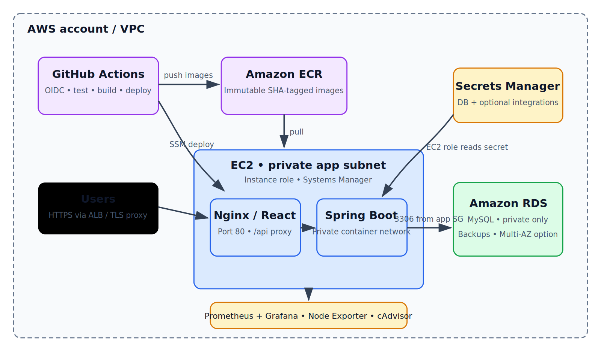

# AWS setup and deployment

AWS account resources are intentionally not created from this repository. The account used for preparation was unavailable, so the instructions and pipeline are reproducible configuration, not evidence of a live deployment.

## Architecture

The frontend and backend run as non-root containers on EC2. Nginx serves the React bundle on port 80 and proxies `/api/` to the backend over a private Docker network. The backend connects to MySQL on private RDS. GitHub Actions authenticates through OIDC to publish immutable SHA images to ECR and invokes the EC2 deployment through Systems Manager. The EC2 instance role grants ECR image pull, Secrets Manager read, and SSM managed-instance permissions. Prometheus/Grafana, Node Exporter, and cAdvisor run on the host as described in the root Compose file; restrict their access to administrators.

## Network and security groups

1. Use a VPC with public ingress/load-balancer subnets and private application/database subnets where practical. Avoid a public RDS address.
2. Allow internet ingress on HTTPS (443) at an ALB or TLS-terminating reverse proxy; port 80 may redirect to HTTPS. If exposing EC2 directly for a demo, allow only the required web ports. Keep the backend container port private to the EC2 Docker network.
3. Prefer Systems Manager Session Manager over SSH; do not open port 22 when it is not required. If SSH is required for a controlled break-glass path, restrict its source to an administrator IP or trusted runner security group, never `0.0.0.0/0`.
4. Configure the RDS security group to accept MySQL/TCP 3306 only from the EC2 application security group. Set RDS `Publicly accessible` to **No**.
5. Permit monitoring ports only from trusted operator networks or an authenticated proxy. Do not expose unauthenticated Prometheus, Grafana, Node Exporter, or cAdvisor ports publicly.

## EC2, RDS, IAM

- Launch a supported Linux AMI with Docker Engine, AWS CLI, `jq`, and the SSM Agent. Attach an instance profile with `AmazonSSMManagedInstanceCore`, ECR pull access restricted to the two app repositories, and `secretsmanager:GetSecretValue` restricted to the app secret ARN. Do not place AWS access keys on the instance.
- Create a private MySQL RDS instance and a database/user for the app. Enable encryption, automated backups and an appropriate retention period; choose Multi-AZ based on availability requirements. Use a database subnet group in private subnets and the restricted security group above.
- Store a JSON object in Secrets Manager at the secret ARN provided to the workflow. Required keys: `SPRING_DATASOURCE_URL` (including the private RDS host and database), `SPRING_DATASOURCE_USERNAME`, `SPRING_DATASOURCE_PASSWORD`, `CORS_ALLOWED_ORIGIN`; optional keys: `COHERE_API_KEY`, `SLACK_WEBHOOK_URL`.
- Create ECR repositories named `${ECR_REPOSITORY}-backend` and `${ECR_REPOSITORY}-frontend`; configure lifecycle policies to expire old untagged images without deleting rollback tags prematurely.
- Create a GitHub Actions OIDC provider and a deployment role trusted only for this repository and the `main` branch. Grant the role ECR push permissions scoped to the two repositories, `ssm:SendCommand` scoped to the target instance/document, and the minimum `ssm:GetCommandInvocation`/`ssm:ListCommandInvocations` permissions needed to verify the command. Do not use long-lived AWS user keys.

## GitHub configuration

Add these **repository variables**:

| Variable | Example |
| --- | --- |
| `AWS_REGION` | `us-east-1` |
| `ECR_REGISTRY` | `123456789012.dkr.ecr.us-east-1.amazonaws.com` |
| `ECR_REPOSITORY` | `todo-summary-assistant` |

Add these **repository secrets**:

| Secret | Value |
| --- | --- |
| `AWS_DEPLOY_ROLE_ARN` | ARN of the GitHub OIDC deployment role. |
| `EC2_INSTANCE_ID` | SSM-managed target instance ID. |
| `APP_SECRET_ARN` | ARN of the JSON Secrets Manager secret described above. |

The workflow runs backend and frontend checks on pushes and pull requests; pull requests build images without publishing. Pushes to `main` assume the OIDC role, publish SHA-tagged images to ECR, and invoke `aws/deploy.sh` on EC2 through SSM. SSM output is polled and the job fails unless both application health checks pass. `aws/deploy.sh` fetches runtime config using the instance role and attempts to restore the previous image references on failure.

Use an ALB/HTTPS endpoint or controlled public DNS for the frontend and set `CORS_ALLOWED_ORIGIN` to that exact browser origin. This implementation publishes Nginx on EC2 port 80; terminate TLS in a properly secured ALB/reverse proxy for production. No AWS credentials or real environment values belong in Git.
